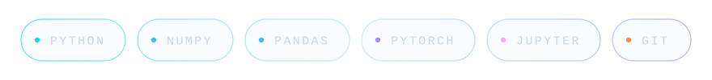
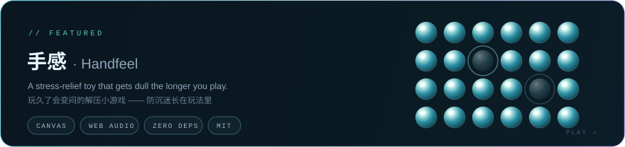

  

 

  

 

## ▍ About · 关于

I'm 顾欢 (Gu Huan) — a student, and I'm early. I picked machine learning as the thing I want to understand deeply, and I'm working through it from the bottom — Python first, then the math, then the models.

I learn by building small things that mostly break, reading the traceback, and fixing them. Everything here is a work in progress, including me.

What pulls me in: how far a few lines of math can go, and why some models generalize while others only memorize.

> 我是顾欢，一名刚起步的学生。我把机器学习选作想真正吃透的方向，正从最底层往上走——先 Python，再数学，最后才是模型。
>
> 我的学法是：做点小东西，大多是坏的，然后读 traceback、把它修好。这里的一切都还在进行中，包括我自己。
>
> 最吸引我的是：几行数学能走多远，以及为什么有些模型能泛化，有些只是在背答案。

## ▍ Currently Learning · 正在学

*Four things, in this order. No shortcuts, no jumping ahead.*

- **Python** — syntax, data structures, writing code I can still read a week later
- **NumPy / pandas** — moving data around without writing a loop for everything
- **Math for ML** — linear algebra and calculus, until the gradients actually make sense
- **PyTorch** — tensors → autograd → a training loop that converges

> 四件事，按这个顺序。不抄近路，不跳步。
>
> - **Python** — 语法、数据结构，练到写出的代码过一周自己还看得懂
> - **NumPy / pandas** — 处理数据不必什么都手写循环
> - **机器学习数学** — 线性代数与微积分，直到梯度真正讲得通
> - **PyTorch** — 张量 → 自动求导 → 一个能收敛的训练循环

## ▍ Toolbox · 工具箱

*Learning these, not claiming mastery of them.*

  

> 这些是我正在学的工具，不是我已经精通的。

## ▍ Featured · 项目

  

解压产品不该靠制造焦虑来留住人。所以这个游戏玩得越久手感越钝——「防沉迷」长在玩法里，不在弹窗里。 · [源码](https://github.com/huan0-gg/handfeel) · [在线试玩](https://huan0-gg.github.io/handfeel/)

## ▍ Connect · 联系

The fastest way to reach me is email. I read everything, and I reply faster than I commit.

> 找我最快的方式是邮件。每封都会看，而且回得比提交代码还快。

 

  

 

  <i>Reading papers. Writing bad code. Getting better.</i>
   
  <i>读论文，写烂代码，慢慢变好。</i>

